<picture>
  <source media="(prefers-color-scheme: dark)" srcset="readmefile/dark.svg">
  <source media="(prefers-color-scheme: light)" srcset="readmefile/light.svg">
  
</picture>

# Denis Samatov

**Machine Learning Engineer & Technical Lead**

I build LLM agents and RAG systems, and work on reproducible ML for scientific computing and medical imaging. I share runnable demos, regression tests, and benchmark results that show where a method works and where it breaks.

**Follow here on GitHub** for new releases, evaluation examples, and reproducible benchmarks.

## Start with a demo or benchmark

| Project | What you can try or inspect |
| --- | --- |
| [**Agent Reliability Platform**](https://github.com/denis-samatov/agent-reliability-platform) | Inspect a tool-using agent with crash recovery, idempotent retries, and human approvals. [Read the scenario evaluation](https://github.com/denis-samatov/agent-reliability-platform/blob/main/results/EVAL.md). |
| [**LocalDesk**](https://github.com/denis-samatov/localdesk) | Run a CPU text classifier that sends uncertain predictions for review. [Try two predictions](https://github.com/denis-samatov/localdesk#try-it-in-10-seconds). |
| [**mcp-capguard**](https://github.com/denis-samatov/mcp-capguard) | Use pytest to check which tools an MCP server exposes. [Run the one-minute demo](https://github.com/denis-samatov/mcp-capguard#see-the-regression-in-one-minute). |
| [**Tensor-Based Modal Decomposition**](https://github.com/denis-samatov/tensor-based-modal-decomposition-method) | Verify stored results for sparse sensing and reservoir-state reconstruction. [Open the reproducibility guide](https://github.com/denis-samatov/tensor-based-modal-decomposition-method/blob/main/REPRODUCIBILITY.md). |
| [**RuMed ICD benchmark**](https://github.com/denis-samatov/rumed-icd-llm) | Compare TF-IDF, prompting, retrieval, and LoRA on 822 held-out Russian clinical complaints. [See the results](https://github.com/denis-samatov/rumed-icd-llm#results). |
| [**LLM Systems Lab**](https://github.com/denis-samatov/llm-systems-lab) | Inspect CPU benchmarks for distributed training, checkpoint recovery, and LLM inference. [Read the benchmark report](https://github.com/denis-samatov/llm-systems-lab/blob/main/results/REPORT.md). |

[Engineering and research case studies](docs/selected-projects.md) · [Yandex Workspace MCP](https://github.com/denis-samatov/yandex-workspace-mcp) · [Agent architecture notebooks](https://github.com/denis-samatov/agentic-architectures) · [Traceable RAG case study](https://github.com/denis-samatov/llm-adviser-case-study)

## Tech stack

  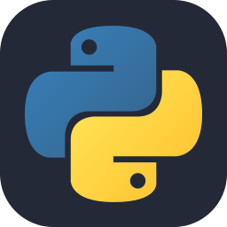
  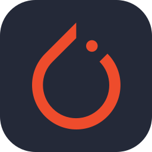
  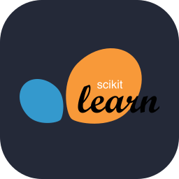
  
  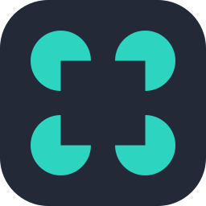
  
  
  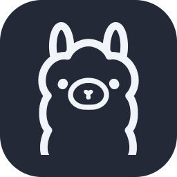
  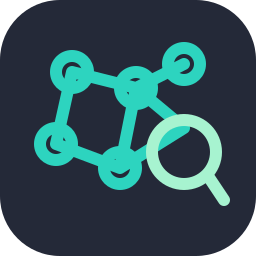
  
  
  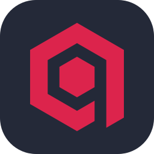
  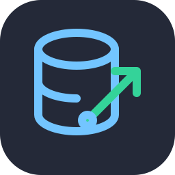
  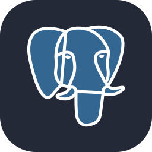
  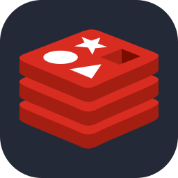
  
  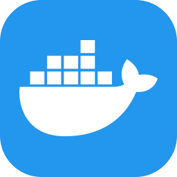
  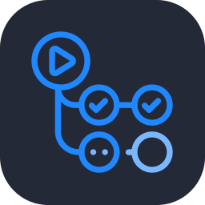
  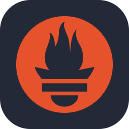
  
  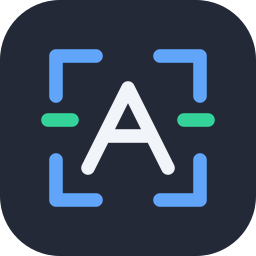
  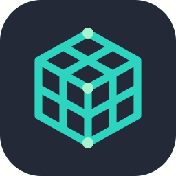
  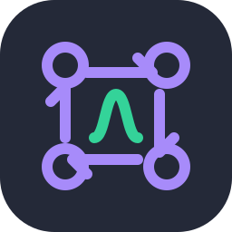

## Open-source contributions

- [NCI Imaging Data Commons](https://github.com/ImagingDataCommons/IDC-Tutorials/pull/116) — tutorial on aligned CT/DICOM SEG tensors and patient-level train/test splits.
- [Weaviate Python client](https://github.com/weaviate/weaviate-python-client/pull/2186) — read-only backup permissions and role parsing. [DigitalOcean generative integration](https://github.com/weaviate/weaviate-python-client/pull/2153).
- [IBM Docling Pipelines](https://github.com/IBM/docling-pipelines/pull/31) — side-effect-free dry runs and regression coverage.
- [Dragonfly](https://github.com/dragonflydb/dragonfly/pull/8199) — missing-index behavior for RedisVL compatibility. [W&B RAI Toolkit](https://github.com/wandb/rai-toolkit/pull/24) — HR evaluation preset and tests.

## Research and collaboration

My research includes **EPIFAT**, state-registered software for cardiac CT segmentation and epicardial fat radiomics (No. 2025610317), [cardiac MRI radiomics](https://jdigitaldiagnostics.com/DD/article/view/630602), and [tensor methods for sparse sensing](https://arxiv.org/abs/2607.09687). The TBMD repository documents the revised benchmark and reproducibility status of the preprint.

I'm open to collaborating on agent evaluation, reproducible scientific ML, and medical imaging workflows. For project-specific feedback or reproducibility reports, open an issue in the relevant repository.

[CV (PDF)](Denis_Samatov_CV_ML_Engineer.pdf) · [LinkedIn](https://www.linkedin.com/in/denis-samatov/) · [ORCID](https://orcid.org/0009-0000-1821-323X) · [Google Scholar](https://scholar.google.com/citations?user=GvQy91AAAAAJ) · [Email](mailto:denissamatov470@gmail.com)

Professional experience and additional projects

- **MSUU** — Machine Learning Engineer / Technical Lead. Team projects include CourseLLM and a housing knowledge-base assistant with retrieval and answer quality gates.
- **Heriot-Watt TPU Center** — Research ML Engineer. Tensor methods for sparse sensing and engineering knowledge retrieval.
- **Cardiology Research Institute** — Machine Learning Engineer. CT/MRI segmentation, radiomic feature extraction, and clinical decision support research.

[Evidence graphs and retrieval](https://github.com/denis-samatov/evigraph) · [Bayesian inference on PyPI](https://pypi.org/project/nab-bayes/) · [OCR and document AI](https://github.com/denis-samatov/ocr-llm-document-pipeline)

